# 肺結節良惡性輔助系統

淡江大學資訊工程系 專題成果。以 YOLOv11 偵測 CT 切片中的肺結節，再以雙輸入卷積神經網路（結節 ROI ＋ 完整 CT 切片）判斷良惡性，最後以 PyQt 介面整合，輔助醫師判讀。

> 本分支（`restore-original`）還原專題成果報告書當時的版本，**不含**之後的優化（3D、Lung-RADS、PDF 報告等）。還原過程與設定見 [REPRODUCE.md](REPRODUCE.md)。

## 摘要

肺癌是全球最常見的癌症之一，及早發現肺結節對提高存活率至關重要。本專題利用 LIDC-IDRI 公開資料集，以物件偵測模型 YOLOv11 偵測肺結節，再以雙輸入 CNN 判斷結節良惡性，並搭配 PyQt 設計出具有使用者介面的軟體，期望提升肺結節 CT 影像的判讀效率與準確性，減輕醫師負擔。

## 研究動機與目標

- 肺結節需由專業放射科醫師從電腦斷層（CT）判讀，不同醫師的經驗與觀點不同，可能得到不同診斷。
- 目標：讓醫師能透過本系統提升良惡性判斷的正確率，並降低診斷工作負擔。

## 專題流程

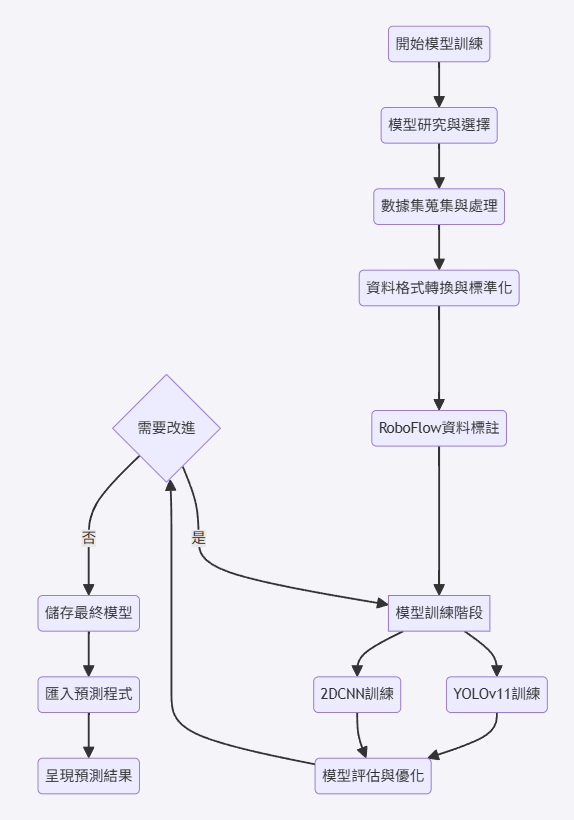

## 研究方法

### 1. 資料集

- **LIDC-IDRI**：約一千多件胸部 CT（`.dcm`）與 1 到 4 位放射科醫師的標註（`.xml`），記錄結節位置與特徵。
- 本專題採用 **LUNA16** 的篩選方式：捨棄切片厚度大於 2.5 mm、結節小於 3.0 mm、以及僅 1～2 位醫師標記的影像，約八百多件。

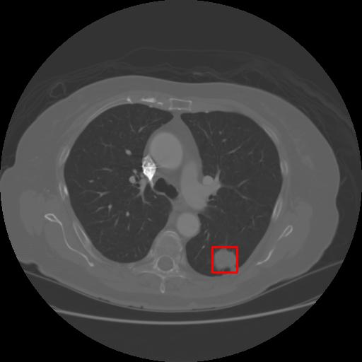

### 2. YOLO 肺結節偵測

1. 將 XML 標記的「有結節切片」與「非結節切片」轉成 `.png`，醫師標記座標轉成 COCO.json（`preprocessing/`）。
2. 上傳 Roboflow 做標記管理與資料分配，下載為 YOLOv11 格式（單一類別 `nodule`）。
3. 模型選用最大的 **YOLOv11x**，本地訓練（`detection_yolo/`）。訓練設定：`imgsz=640`、`optimizer=SGD`、`patience=20`、最多 350 epochs。

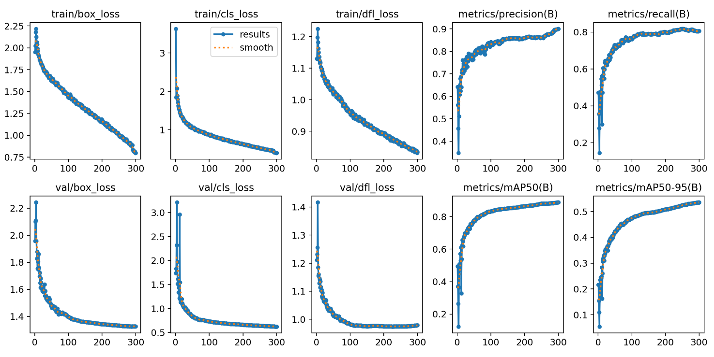

### 3. 良惡性分類（Dual Input Nodule Classifier）

- 參考 Gao 等人（2017）的七層 CNN 作為基準模型，再加入「完整 CT 路徑」改成雙輸入。
- **ROI 路徑**：32×32，三層 3×3 卷積（32→64→128），輸出 2048 維特徵。
- **完整 CT 路徑**：640×640，四層卷積（7×7→5×5→3×3→3×3），輸出 3200 維特徵。
- 兩路徑合併為 **5248 維**，經三層全連接（256→128→2），搭配批次正規化與 Dropout（0.5），最後 Softmax 輸出良／惡性。
- 標籤：醫師 malignancy 評分 ≤2 為良性、≥4 為惡性，3 分（不確定）不納入（`classification_cnn/dataloader.py`）。
- 實際最終權重（`dual_input_final_model.pth`）在兩條路徑加入了殘差與 CBAM 注意力區塊；說明書的模型圖為簡化版。

| ROI 路徑 | 完整 CT 路徑 | 融合 |
|:--:|:--:|:--:|
| 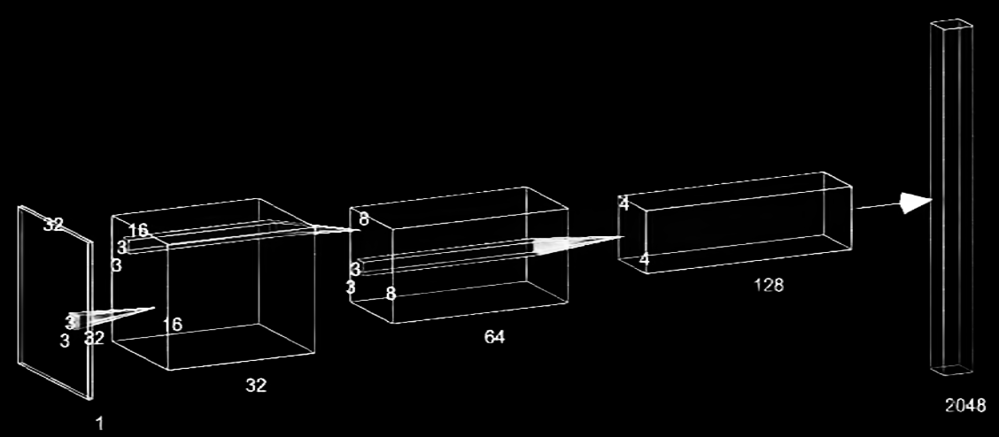 | 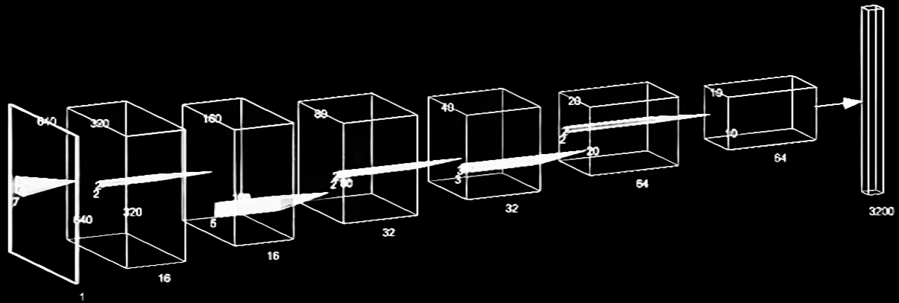 | 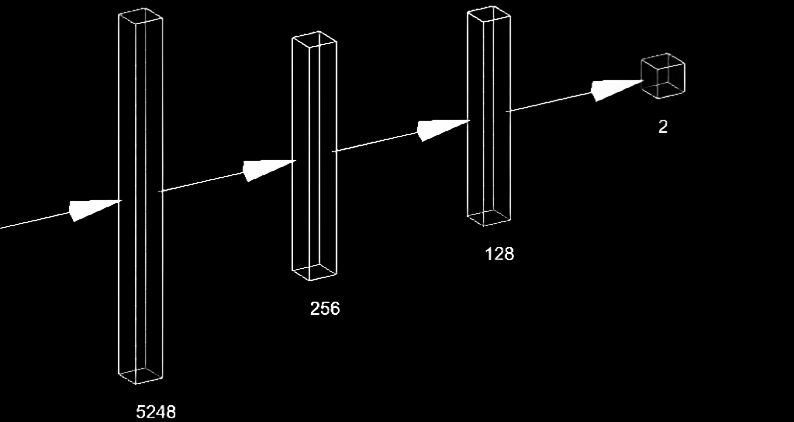 |

### 4. GUI 整合

流程：載入病人 CT 切片組 → YOLO 偵測 → 連續至少 2 張切片偵測到才視為結節 → 以結節為中心裁出 32×32 ROI → 與完整 CT 一併輸入雙輸入 CNN → 顯示良惡性（紅字惡性、綠字良性）。

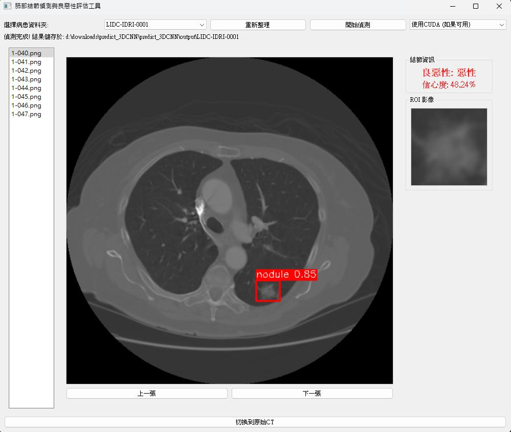

| 惡性 | 良性 |
|:--:|:--:|
| 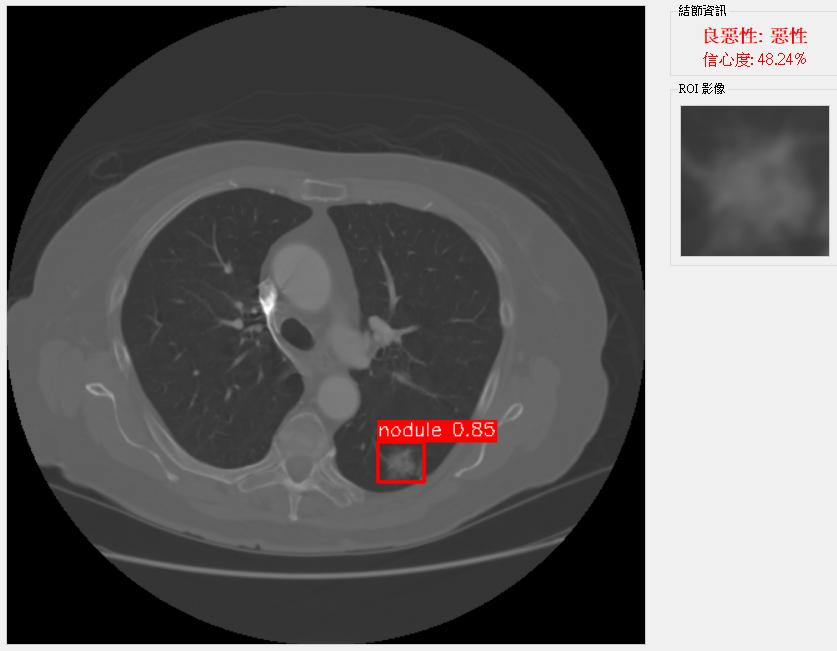 | 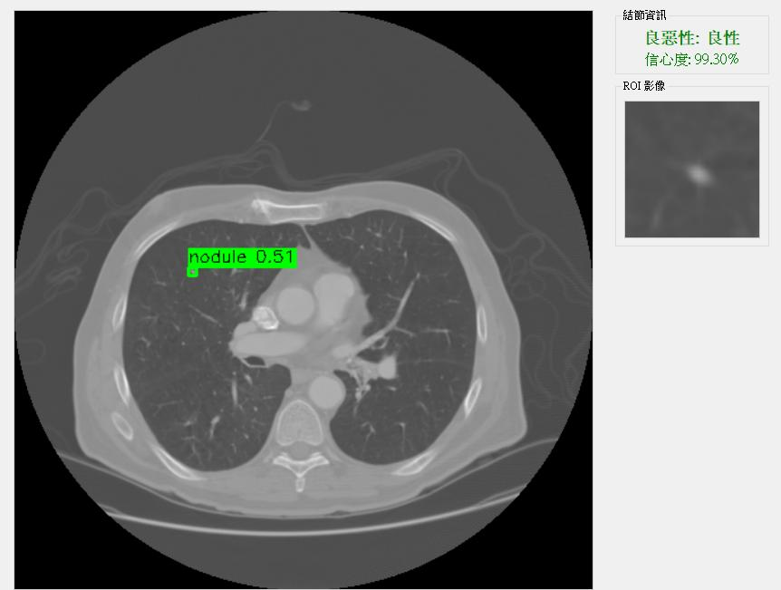 |

## 結果

### 說明書報告的結果

**YOLOv11x 偵測**：Precision 約 0.90、Recall 約 0.80、mAP@0.5 超過 0.88、mAP@0.5:0.95 超過 0.70。

**分類器**（說明書第 5.2 節）：

| 指標 | 簡易 CNN | 雙輸入模型 |
|---|---|---|
| 準確率 | 84.30% | 94.70% |
| 召回率 | 89.52% | 94.70% |
| 特異度 | 78.61% | 94.60% |
| AUC | 0.919 | 0.984 |
| 假陽性 (FP) | 172 | 38 |
| 假陰性 (FN) | 92 | 50 |

> 註：說明書文字的 FP／FN 與混淆矩陣圖的標示方向相反，上表依說明書文字。

| 簡易 CNN | 雙輸入模型 |
|:--:|:--:|
| 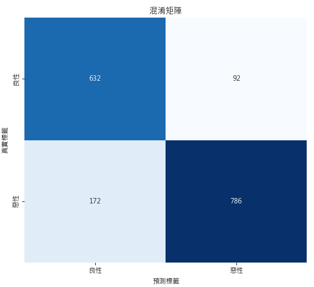 | 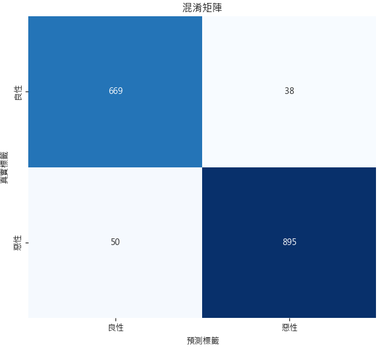 |
| 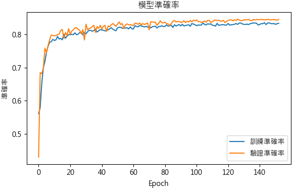 | 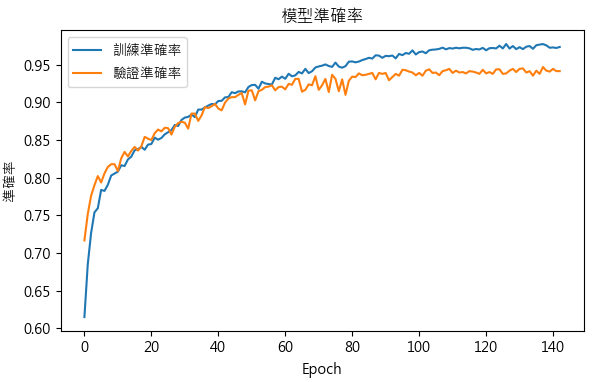 |
| 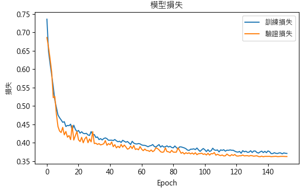 | 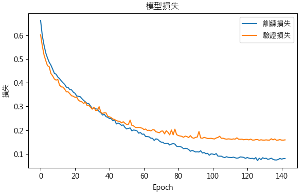 |

### 本次還原的結果

使用同樣的資料規則（LIDC-IDRI 中 LUNA16 的 888 件 CT，原作者腳本）重建資料並重新訓練，**切分方式與說明書相同（切片層級隨機 70/20/10）**。

| 指標 | 說明書（雙輸入） | 還原（測試集 901 筆） |
|---|---|---|
| 準確率 | 94.70% | 94.89% |
| 召回率 | 94.70% | 96.66% |
| 特異度 | 94.60% | 92.60% |
| AUC | 0.984 | 0.983 |
| FP／FN | 38／50（測試 1652 筆） | 29／17（測試 901 筆） |

YOLO 偵測的還原結果（YOLO11x，350 epoch 設定，第 292 epoch 由 patience=20 提早停止，最佳為第 281 epoch；測試集 1,785 張）：

| 測試集範圍 | 模型 | P | R | mAP50 | mAP50-95 |
|---|---|---|---|---|---|
| 說明書 | 作者 | ≈0.90 | ≈0.80 | >0.88 | >0.70 |
| 全部 1,785 張（含 825 張無結節圖） | 本次重訓 | 0.765 | 0.811 | 0.808 | 0.469 |
| 全部 1,785 張 | 作者權重 `best.pt` | 0.857 | 0.861 | 0.873 | 0.592 |
| 僅有結節的 960 張 | 本次重訓 | 0.877 | 0.840 | 0.886 | 0.511 |
| 僅有結節的 960 張 | 作者權重 `best.pt` | 0.937 | 0.899 | 0.938 | 0.634 |

說明：
- 召回率與 mAP50 達到說明書水準（以僅含結節圖計）；精確率略低；mAP50-95 未達 0.70，作者權重在本次資料上也只有 0.59 到 0.63，表示框標註或資料切分與原版有差異，不是重訓造成。
- 作者測試集的挑選方式未知，作者權重可能看過本次測試圖，其數字偏樂觀。
- 與原設定的差異：batch 8（原 16，顯卡 11GB），其餘依截圖設定。
- 端到端（YOLO 框接分類器）未評測。

## 已知限制

- 資料以切片為單位隨機切分，**同一病人的切片可能同時出現在訓練與測試集**，準確率偏樂觀（說明書「未來展望」亦提及）。
- 分類器以醫師標註的框訓練與評測；實際系統使用 YOLO 預測框，兩階段合併的表現未在說明書中量測。
- 分類器訓練以 `(x/255-0.5)/0.5` 正規化，原 GUI 推論使用 `x/255`，兩者不一致。

## 未來展望

採用多重視角或 3D 模型，讓模型學習連續切片的特徵，提升在單一切片上不明顯結節的偵測準確率。

## 專案結構

- `preprocessing/`：LIDC-IDRI XML 解析、COCO.json 轉換、前處理腳本
- `detection_yolo/`：YOLOv11 訓練設定
- `classification_cnn/`：雙輸入 CNN 的資料載入與訓練
- `gui_app/`：PyQt5 整合介面（`cnn_detector_v1.py`）
- `reproduce/`：還原腳本（見 [REPRODUCE.md](REPRODUCE.md)）
- `docs/images/`：說明書圖片
- `movefile.py`、`annallcsv.py`、`patient_sop_uids.csv`：最早期的資料整理腳本與病人對照表

## 快速開始

1. 安裝套件：`pip install ultralytics pydicom PyQt5 torch opencv-python tqdm`
2. 取得權重（`best.pt`、`dual_input_best_auc_model.pth`，不含於 git，sha256 見 [REPRODUCE.md](REPRODUCE.md)），放到 `gui_app/`
3. 將病人資料夾放在程式目錄下，執行：`python gui_app/cnn_detector_v1.py`

## 早期資料整理腳本（2024-12）

- **`movefile.py`**：下載 LIDC-IDRI 時未只選 CT，且 DICOM 需開兩層資料夾才到，此程式把 `.dcm` 較多的資料夾內容搬到根目錄，並刪除其餘不必要資料；只會刪除根目錄底下的子目錄，不會動到原始資料。
- **`annallcsv.py`**：從 XML 取出醫師描繪的結節切片座標，轉成 COCO.json，並將有病徵的切片與 `.json` 以 SOP UID 命名，上傳 Roboflow 時能自動配對標記。
- **`patient_sop_uids.csv`**：記錄每個 SOP UID（切片）屬於哪位病人。

資料庫來源：[TCIA LIDC-IDRI](https://www.cancerimagingarchive.net/collection/lidc-idri/)；資料標記與分配：[Roboflow](https://universe.roboflow.com/lungcancerct/max_lung_img/dataset/1)

## 研究團隊

淡江大學資訊工程系：陳威丞、廖柏維、鍾翔宇、江昊宸

## 參考文獻

1. Jocher, G. (2023). 介紹 Ultralytics YOLO11. https://docs.ultralytics.com/zh
2. Huang, T. (2018). 深度學習-物件偵測: You Only Look Once (YOLO). Medium.
3. Huang, T. (2018). 深度學習-什麼是 one stage，什麼是 two stage 物件偵測. Medium.
4. jaeho3690 (2020). LIDC-IDRI-Preprocessing. GitHub. https://github.com/jaeho3690/LIDC-IDRI-Preprocessing
5. Gao, J. et al. (2017). Using Deep Learning for Classification of Lung Nodules on Computed Tomography Images. https://onlinelibrary.wiley.com/doi/10.1155/2017/8314740
6. 楊順貿 (2017). 失控的肺結節. 台大醫院新竹台大分院.
